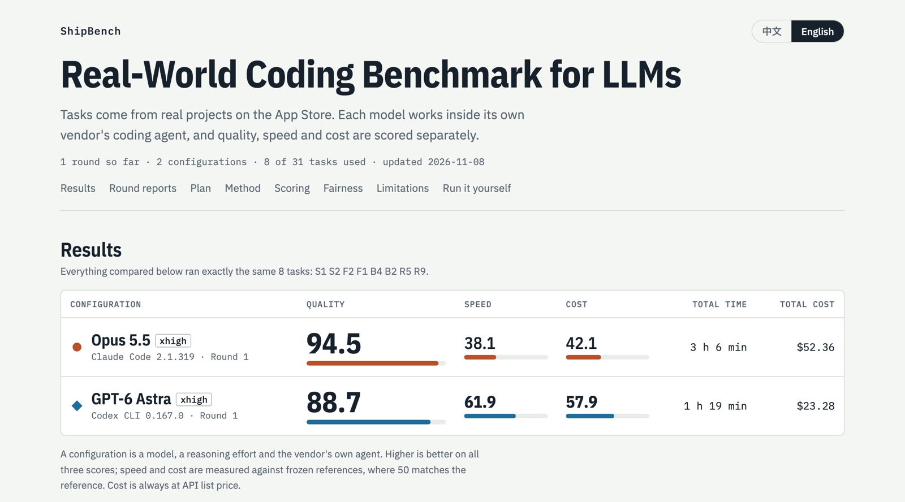

# ShipBench

**Real-World Coding Benchmark for LLMs.** Tasks come from real projects on the App Store. Each model works inside its own vendor's coding agent, and quality, speed and cost are scored separately.

[中文说明](README.zh-CN.md)

**[Open the overview →](https://claude.ai/artifact/PqeRTZmWJeqaGeKXWWwdBB#en)** Results of every round, the full report for each one, the plan and the method.

## In this repository

| Folder | Contents |
|---|---|
| [`reports/`](reports) | One folder per round: full report, scores, diffs, rationales and videos |
| [`tasks/`](tasks) | The 31-task bank |
| [`rounds/`](rounds) | What each round ran, and the frozen speed and cost references |
| [`runner/`](runner) | Run and grade tasks. [Run it yourself](runner/README.md) |
| [`overview/`](overview) | Source and data of the overview page |
| [`player/`](player), [`tools/`](tools) | Simulator replay project and helper scripts |

## License

- Code (`runner/`, `player/`, `tools/`): MIT.
- Tasks (`tasks/`), including starting code taken from commercial apps and their assets: [CC BY-NC 4.0](tasks/LICENSE.md). Use them to evaluate and research, not to ship. Third-party files keep their own licenses (fonts: SIL OFL; ShipSwift components and docs: MIT; photos: Unsplash License).
- Reports (`reports/`, `overview/`): [CC BY 4.0](reports/LICENSE.md).

Maintained by [SignerLabs](https://github.com/signerlabs).
