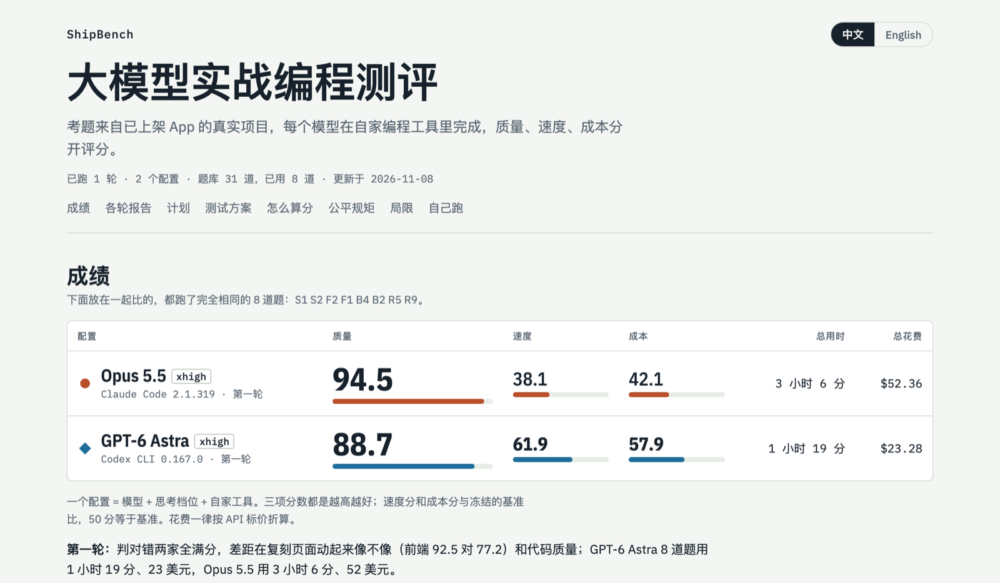

# ShipBench

**大模型实战编程测评。** 考题来自已上架 App 的真实项目，每个模型在自家编程工具里完成，质量、速度、成本分开评分。

[English](README.md)

**[打开总览 →](https://claude.ai/artifact/PqeRTZmWJeqaGeKXWWwdBB#zh)** 各轮成绩、每一轮的完整报告、计划和测试方案都在这里。

## 仓库内容

| 目录 | 内容 |
|---|---|
| [`reports/`](reports) | 每轮一个目录：完整报告、分数、改动、评分理由和视频 |
| [`tasks/`](tasks) | 31 道题的题库 |
| [`rounds/`](rounds) | 每轮跑了什么，以及冻结的速度、成本基准 |
| [`runner/`](runner) | 跑题和判分。[自己跑](runner/README.md) |
| [`overview/`](overview) | 总览页的源文件和数据 |
| [`player/`](player)、[`tools/`](tools) | 模拟器回放工程和小工具 |

## 许可证

- 程序（`runner/`、`player/`、`tools/`）：MIT。
- 题目（`tasks/`，包括取自商业 App 的底稿和素材）：[CC BY-NC 4.0](tasks/LICENSE.md)，可用于评测和研究，不可商用。第三方文件沿用各自的许可证（字体是 SIL OFL；ShipSwift 组件和文档是 MIT；照片是 Unsplash License）。
- 报告（`reports/`、`overview/`）：[CC BY 4.0](reports/LICENSE.md)。

由 [SignerLabs](https://github.com/signerlabs) 维护。
